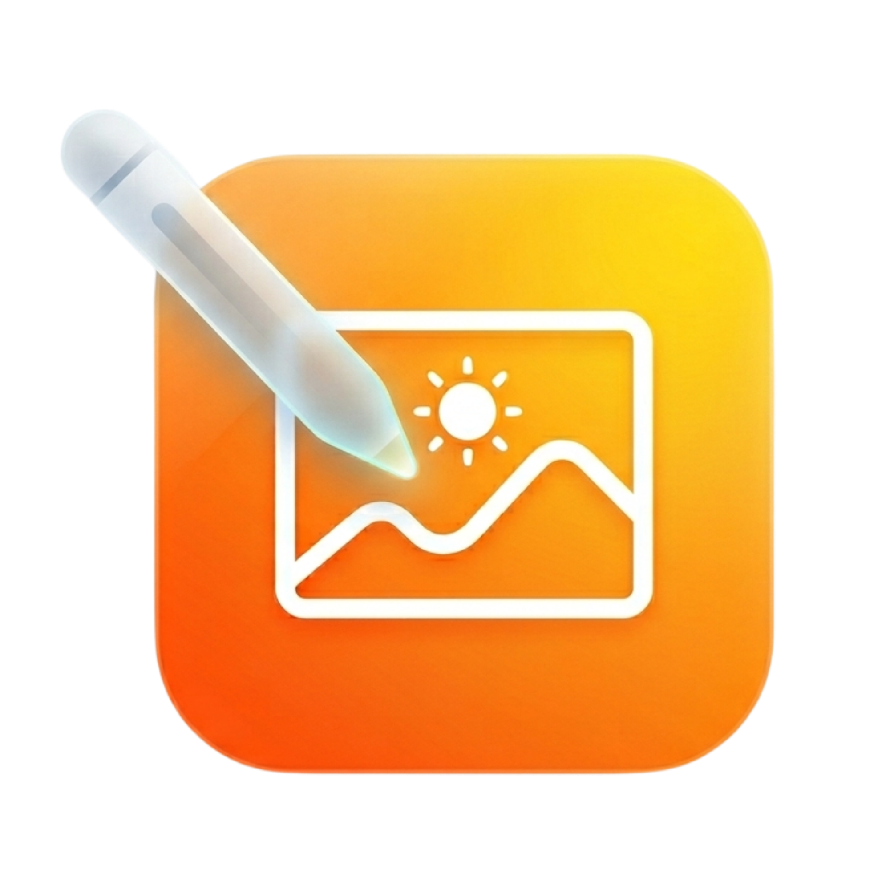
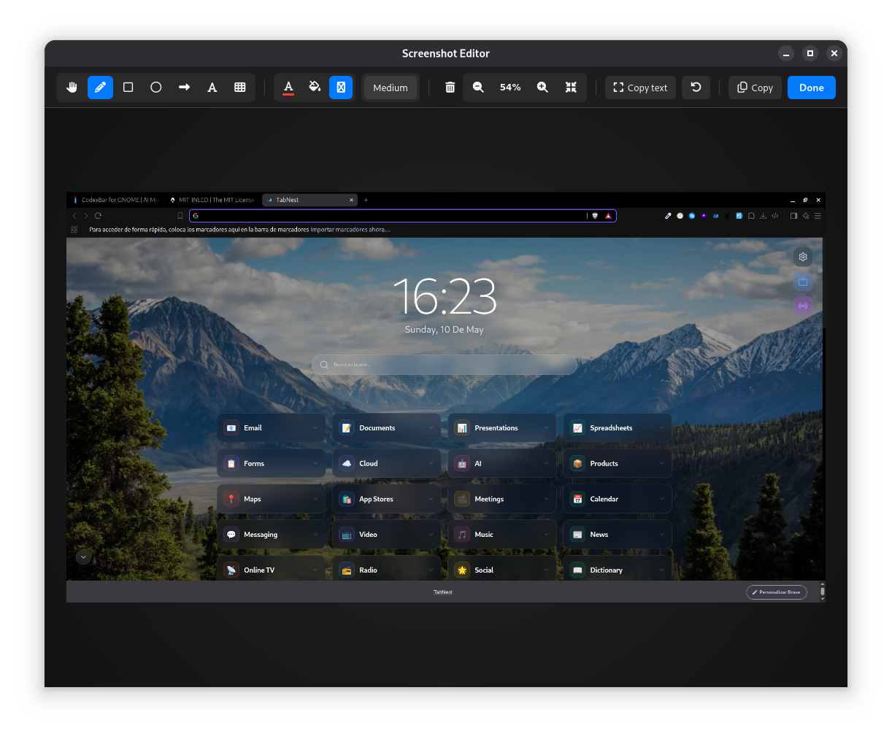

<p align="center">
  
</p>

<h1 align="center">Screenshot Annotator</h1>

<p align="center">
  A professional-grade GNOME Shell extension that brings a macOS-inspired annotation workflow to your desktop. It automatically monitors your screenshots folder and opens a feature-rich editor the moment a new capture is detected.
</p>

<p align="center">
  
</p>

## Core Features

- **Automated Workflow**: Detects new screenshots instantly and opens them in the editor.
- **Precision Tools**: Freehand drawing, geometric shapes (rectangles, circles), and arrows.
- **Advanced Editing**: Add text annotations and pixelate sensitive information for privacy.
- **Smart OCR**: Extract text from images using the system's Tesseract engine.
- **Seamless Integration**: One-click "Copy to Clipboard" or "Save to Disk" to keep your workflow fast.
- **Offline & Private**: No external network requests; all processing is done locally on your machine.

## Prerequisites

To enable the OCR (Optical Character Recognition) functionality, ensure `tesseract` is installed on your system:

- **Fedora**: `sudo dnf install tesseract`
- **Ubuntu/Debian**: `sudo apt install tesseract-ocr`
- **Arch Linux**: `sudo pacman -S tesseract`

## Installation

### Manual Installation
1. Clone this repository.
2. Run the installation script:
   ```bash
   ./install.sh
   ```
3. Restart GNOME Shell (`Alt+F2`, type `r`, and press `Enter`).
4. Enable the extension via **Extensions** or **Extension Manager**.

## Publication Status

This extension is currently optimized for submission to the GNOME Extensions Store (EGO). It adheres to all modern standards, including ESM (GJS), GTK4/GTK3 hybrid compatibility, and strict resource management to prevent memory leaks.

---
Developed by **inled.es**
